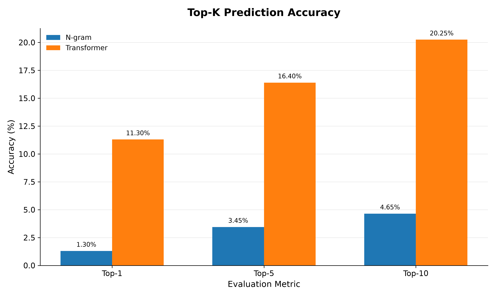
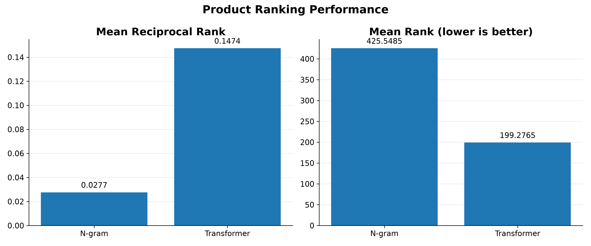
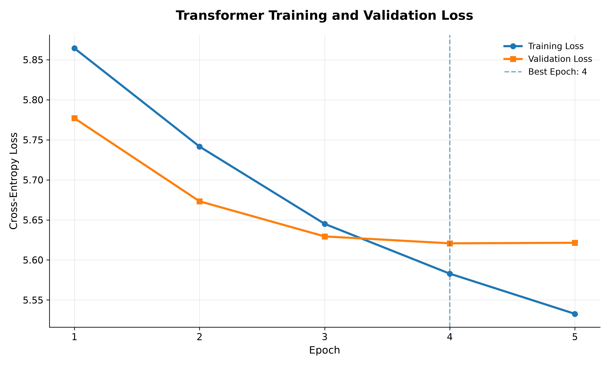
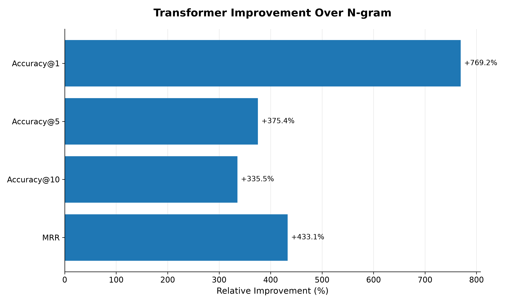

# Retail Basket Prediction Analyzer


A comparative study of **N-gram and Transformer-based language models** for retail basket completion prediction using synthetic shopping basket data.


[](https://github.com/anusree160/retail-basket-prediction-analyzer/actions/workflows/ci.yml)


---


## 1. Project Overview


Retail businesses analyze customer purchasing patterns to understand which products are likely to be purchased together.


This project develops a Retail Basket Prediction Analyzer that compares two approaches to predicting a missing product in a shopping basket:


- **N-gram Model:** A statistical model that learns item co-occurrence patterns from previous basket sequences.

- **Transformer Language Model:** A small GPT-style causal Transformer trained on retail basket sequences using PyTorch.


Both models are trained and evaluated using the same synthetic retail dataset to provide a fair performance comparison.


### Project Objectives


- Generate synthetic shopping baskets containing planted product associations.

- Implement an N-gram-based prediction model.

- Train a small Transformer language model.

- Evaluate both models using ranking and prediction metrics.

- Compare their performance through research-oriented visualizations.


---


## 2. Project Milestones


All five project milestones have been completed.


- [x] **Milestone 1:** Generate a synthetic dataset of shopping baskets with planted itemsets.

- [x] **Milestone 2:** Implement an N-gram model for product prediction.

- [x] **Milestone 3:** Train a small Transformer language model on basket sequences.

- [x] **Milestone 4:** Evaluate both models using next-item prediction metrics.

- [x] **Milestone 5:** Compare model performance using metrics and visualizations.


---


## 3. Dataset


The project uses a synthetically generated retail basket dataset.


| Dataset property | Value |

|---|---:|

| Total shopping baskets | 20,000 |

| Unique products | 1,000 |

| Planted itemsets | 32 |

| Frequent itemsets discovered | 65,117 |

| Average basket size | 9.54 products |

| Random seed | 42 |


The dataset is generated using the `thilimarketbasket` package.


The generated data includes product catalogs, basket sequences, planted itemsets, and metadata.


The dataset is split into:


- 80% Training data

- 10% Validation data

- 10% Testing data


Both models use the same training and test split.


---


## 4. Model Architecture


### 4.1 N-gram Model


The N-gram model predicts products based on previously observed products in a basket.


Implementation features:


- Configurable N-gram order.

- Context-based frequency counting.

- Unigram fallback for unseen contexts.

- Additive smoothing.

- Ranked product recommendations.


The primary experiment uses a trigram configuration (`n=3`).


### 4.2 Transformer Language Model


A small GPT-style causal Transformer is implemented using PyTorch.


Architecture:


| Component | Configuration |

|---|---|

| Model type | Causal Transformer |

| Embedding dimension | 128 |

| Attention heads | 4 |

| Transformer blocks | 2 |

| Dropout | 0.1 |

| Maximum sequence length | 64 |

| Parameters | 663,020 |

| Optimizer | AdamW |

| Learning rate | 0.0003 |

| Training epochs | 5 |


The model uses token embeddings, positional embeddings, masked self-attention, feed-forward layers, and a language-model output head.


The best-performing validation checkpoint is saved for evaluation.


---


## 5. Experimental Methodology


The models are evaluated on the same held-out test set.


For each test basket:

1. The products are shuffled using a fixed random seed.

2. One product is hidden.

3. The remaining products are provided as the visible basket.

4. Both models rank candidate products.

5. The position of the hidden product is used to calculate evaluation metrics.


A total of **2,000 test baskets** were evaluated, with no skipped cases.


Already-visible products are excluded from candidate recommendations.


### Evaluation Metrics


- **Accuracy@1:** Percentage of cases where the correct product is ranked first.

- **Accuracy@5:** Percentage of cases where the correct product appears in the top five.

- **Accuracy@10:** Percentage of cases where the correct product appears in the top ten.

- **Mean Reciprocal Rank (MRR):** Measures the average reciprocal rank of the correct product.

- **Mean Rank:** Average ranking position of the correct product. Lower is better.


---


## 6. Experimental Results


The following results were obtained from the held-out test set.


| Evaluation Metric | N-gram | Transformer |

|---|---:|---:|

| Accuracy@1 | 2.05% | **12.05%** |

| Accuracy@5 | 3.50% | **16.90%** |

| Accuracy@10 | 4.65% | **21.35%** |

| MRR | 0.0325 | **0.1551** |

| Mean Rank | 421.26 | **195.44** |


### Key Findings


1. The Transformer achieved the highest performance across all reported metrics.

2. Its top-1 accuracy was approximately 5.9 times that of the N-gram model.

3. Its top-10 accuracy was also substantially higher.

4. The Transformer achieved a lower mean rank, indicating that the correct product was generally positioned closer to the top of its recommendations.

5. The N-gram model provided a simpler statistical baseline, while the Transformer learned more effective sequence representations for this experiment.


**Overall finding:** The Transformer outperformed the N-gram baseline on this synthetic basket-completion task.


---


## 7. Visualizations


Four visualizations were generated to compare the models and examine training performance.


### Top-K Prediction Accuracy





### Ranking Performance





### Transformer Training and Validation Loss





### Relative Model Improvement





All figures are saved in `results/figures/`.


---


## 8. Project Structure


```text

retail-basket-prediction-analyzer/

│

├── .github/

│   └── workflows/

│       └── ci.yml

│

├── app/

│   ├── core.py

│   ├── ngram.py

│   ├── tokenizer.py

│   ├── language_model.py

│   ├── train.py

│   ├── evaluate.py

│   └── visualize.py

│

├── models/

│   └── basket_transformer/

│       ├── best_model.pt

│       ├── tokenizer.json

│       ├── training_history.json

│       └── split_indices.json

│

├── results/

│   ├── evaluation_results.json

│   └── figures/

│

├── tests/

│   └── test_core.py

│

├── .env.example

├── .gitignore

├── pytest.ini

├── requirements.txt

└── README.md

```


The generated dataset is stored locally in `data/` and excluded from Git.


---


## 9. Installation and Usage


### Requirements


- Python 3.12

- Git

- pip


### Step 1: Clone the repository


```bash

git clone https://github.com/anusree160/retail-basket-prediction-analyzer.git

cd retail-basket-prediction-analyzer

```


### Step 2: Create a virtual environment


**Windows:**


```cmd

py -3.12 -m venv .venv

.venv\Scripts\activate

```


**Linux/macOS:**


```bash

python3.12 -m venv .venv

source .venv/bin/activate

```


### Step 3: Install dependencies


```bash

python -m pip install -r requirements.txt

```


### Step 4: Verify the application


```bash

python -m app.cli hello

```


Expected output:


```text

Retail Basket Prediction Analyzer is ready. Open README.md for your milestones.

```


### Step 5: Run the automated tests


```bash

python -m pytest tests/test_core.py -v

```


### Step 6: Run the five milestones


The following commands execute the project pipeline in order:


```bash

python -c "from app.core import milestone_1; print(milestone_1())"

python -c "from app.core import milestone_2; print(milestone_2())"

python -c "from app.core import milestone_3; print(milestone_3())"

python -c "from app.core import milestone_4; print(milestone_4())"

python -c "from app.core import milestone_5; print(milestone_5())"

```


**Note:** Running the pipeline again generates data, trains a new model, evaluates it, and recreates the visualizations. The full training and evaluation process takes longer than running the tests.


---


## 10. Testing and Continuous Integration


The project includes automated tests for all five milestones using `pytest`.


GitHub Actions is configured to execute the tests automatically on:


- Every push to the repository.

- Every pull request.


The workflow uses Ubuntu and Python 3.12, installs the dependencies, and executes the test suite.


**Latest verified test result:** 5 passed, 0 failed locally. GitHub Actions workflow run #2 completed successfully.


[View GitHub Actions](https://github.com/anusree160/retail-basket-prediction-analyzer/actions)


---


## 11. Limitations and Future Improvements


### Current Limitations


- The dataset is synthetic rather than collected from real retail transactions.

- Basket order is shuffled, so the task evaluates basket completion rather than chronological next-purchase forecasting.

- The Transformer is intentionally small and trained for only five epochs.

- Prediction accuracy depends on the dataset structure and experimental configuration.


### Future Improvements


- Experiment with different N-gram orders.

- Tune Transformer architecture and hyperparameters.

- Explore larger datasets containing real retail transactions.

- Investigate optimization techniques such as Genetic Algorithms, Particle Swarm Optimization, and Ant Colony Optimization for hyperparameter search.

- Perform deeper error analysis and evaluate generalization across different datasets.


---


## 12. Conclusion


This project implements and compares a statistical N-gram model and a small Transformer language model for retail basket completion prediction.


Under the experimental setup, the Transformer achieved better top-K accuracy, higher Mean Reciprocal Rank, and lower Mean Rank than the N-gram baseline.


The results demonstrate the potential of Transformer-based sequence models for learning product associations in synthetic retail basket data.


---


## Repository


**GitHub:** https://github.com/anusree160/retail-basket-prediction-analyzer


**Built with:** Python, PyTorch, NumPy, Pandas, Matplotlib, pytest, and thilimarketbasket.


**Project platform:** [askThili](https://ask.thili.ai/b/tfyzt9ankk)
